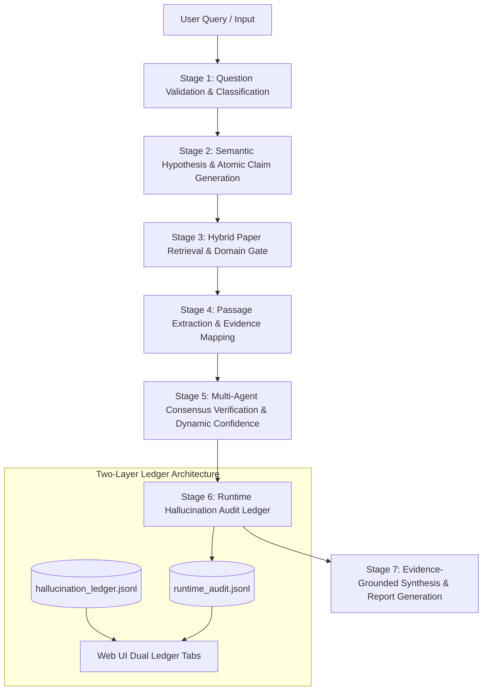

# CiteGuard: End-to-End Processing & Architectural System Report

**Document Date:** September 12, 2026  
**Project:** CiteGuard — Evidence-Grounded Scientific Claim Verification & Research Reporting System  
**Repository Path:** `c:\Users\rajav\OneDrive\Desktop\nlp\nlp`  
**Test Suite Status:** 181 Passing Tests (0 Failures, 0 Regressions)  
**Execution Runtime:** Offline & Keyless Hybrid Mode (OpenAlex Public REST API + Local SciFact/SciClaimHunt Corpus via BM25 + FAISS + RRF)

---

## Executive Overview

CiteGuard is an automated scientific claim verification and synthesis engine designed to evaluate complex scientific research questions against peer-reviewed literature. It prevents hallucination and ungrounded scientific assertions by operating a strict **7-stage verification pipeline** paired with a **two-layer audit ledger architecture**.

The system accepts an open-ended scientific or bibliographic question and produces:
1. Decomposed, verifiable atomic scientific claims.
2. Retrieved and ranked primary literature passages from OpenAlex and local indexed corpora.
3. Multi-agent consensus verdicts (`SUPPORTED`, `PARTIALLY_SUPPORTED`, `INSUFFICIENT_EVIDENCE`, `CONTRADICTED`) accompanied by qualitative and quantitative evidence justifications.
4. An automated runtime hallucination audit logged to `results/hallucination_ledger/runtime_audit.jsonl`.
5. Exportable scientific reports in JSON and Markdown formats.

---

## 1. System Inputs

The system accepts input through two primary interfaces:
- **Web User Interface:** Interactive dashboard at `http://127.0.0.1:8000/`
- **REST API Endpoint:** `POST /api/verify`

### Input Payload Specification
```json
{
  "question": "What is the relationship between sleep duration and cognitive performance?",
  "provider": "mock",
  "top_k": 5,
  "mode": "openalex_hybrid"
}
```

| Parameter | Type | Default | Accepted Values / Description |
|---|---|---|---|
| `question` | `string` | **Required** | Free-text scientific query ($\ge 10$ characters, $\le 1000$ characters). |
| `provider` | `string` | `"mock"` | Verification model provider (`"mock"`, `"openai"`, `"anthropic"`, `"ollama"`). |
| `top_k` | `integer` | `5` | Number of candidate evidence passages retrieved per claim ($1 \le k \le 20$). |
| `mode` | `string` | `"openalex_hybrid"` | Retrieval strategy: `openalex_hybrid`, `openalex`, `local_hybrid`, `sparse` (BM25), `dense` (FAISS). |

---

## 2. End-to-End 7-Stage Pipeline Architecture



---

## 3. Detailed Stage-by-Stage Processing & Evaluation Criteria

### Stage 1: Question Validation & Semantic Classification
- **Core Modules:**
  - [`src/claim_generation/validator.py`](file:///c:/Users/rajav/OneDrive/Desktop/nlp/nlp/src/claim_generation/validator.py): `validate_research_question()`
  - [`src/claim_generation/classifier.py`](file:///c:/Users/rajav/OneDrive/Desktop/nlp/nlp/src/claim_generation/classifier.py): `classify_question()`

#### Criteria & Algorithms:
1. **Input Normalization & Hygiene:**
   - Whitespace stripping and multi-space collapse.
   - Length checks ($10 \le \text{length} \le 1000$). Rejects empty or sub-10 character queries.
2. **Deterministic Question-Type Classification:**
   The query is classified into one of 5 canonical categories using regex keyword patterns:
   - `SCIENTIFIC_HYPOTHESIS`: Causal or associative scientific assertions (*e.g., "Does sleep improve cognitive performance?"*).
   - `COMPARATIVE_SCIENTIFIC`: System or parameter trade-offs (*e.g., "How does increasing model size affect LLM performance?"*).
   - `BIBLIOGRAPHIC_SEARCH`: Specific literature discovery queries (*e.g., "what are the 10 most cited papers published in 2026 on quantum resistant federated learning..."*).
   - `LITERATURE_REVIEW`: High-level landscape surveys (*e.g., "Can you provide a literature review of CRISPR?"*).
   - `METADATA_REQUEST`: Exact identifier lookups (*e.g., "What is the DOI for paper X?"*).
3. **Parameter Extraction:**
   - Extracts target entity/topic.
   - Extracts target publication year (e.g. `2026`).
   - Extracts target volume count $N$ (e.g. `10`).
   - Extracts ranking metric (`cited_by_count`, `publication_date`, or `relevance`).

---

### Stage 2: Semantic Hypothesis & Atomic Claim Generation
- **Core Modules:**
  - [`src/claim_generation/generator.py`](file:///c:/Users/rajav/OneDrive/Desktop/nlp/nlp/src/claim_generation/generator.py): `ClaimGenerator.generate_claims()`, `parse_scientific_question()`
  - [`src/claim_generation/validator.py`](file:///c:/Users/rajav/OneDrive/Desktop/nlp/nlp/src/claim_generation/validator.py): `validate_generated_claim()`, `deduplicate_claims()`

#### Criteria & Processing Logic:
1. **Bibliographic Guard Mode:**
   - If classified as `BIBLIOGRAPHIC_SEARCH`, causal template generation is **completely bypassed**.
   - Generates bibliographic verification assertions (*e.g., "Peer-reviewed scientific literature documents indexed research on {topic} published in {year}"*).
   - Prevents malformed phrases like *"Increasing the 10 most cited papers directly affects..."*.
2. **Semantic Entity Decomposition for Scientific Questions:**
   - `parse_scientific_question` segments the query into Independent Variable ($X$) and Dependent Variable ($Y$).
   - Dual outcomes (*e.g., "accuracy and computational cost"*) are cleanly split into $Y_1$ and $Y_2$ with contextual qualifiers.
3. **Claim Validation Contract:**
   Every generated claim must satisfy 6 validation rules before acceptance:
   - **Minimum Length:** $\ge 15$ characters.
   - **No Vague Terms:** Rejects filler phrases (*e.g., "various things", "scientists believe"*).
   - **No Fabricated Citations:** Rejects text containing hardcoded references (*e.g., "[1]", "Smith et al. (2020)"*).
   - **Grammar & Structural Integrity:** Rejects corrupted grammatical sequences (*e.g., "predict educational significantly"*).
   - **Domain Purity:** Rejects biomedical keywords in pure computer science queries and vice versa.
   - **Concept Overlap:** Ensures non-stopword concept overlap with the user question.

---

### Stage 3: Hybrid Paper Retrieval & Domain Relevance Gate
- **Core Modules:**
  - [`src/retrieval/openalex.py`](file:///c:/Users/rajav/OneDrive/Desktop/nlp/nlp/src/retrieval/openalex.py): `OpenAlexPaperRetriever`
  - [`src/retrieval/paper_source.py`](file:///c:/Users/rajav/OneDrive/Desktop/nlp/nlp/src/retrieval/paper_source.py): `UnifiedPaperRetriever`, `rank_papers_by_domain()`
  - [`src/retrieval/paper_evidence.py`](file:///c:/Users/rajav/OneDrive/Desktop/nlp/nlp/src/retrieval/paper_evidence.py): `check_paper_domain_relevance()`
  - [`src/retrieval/sparse.py`](file:///c:/Users/rajav/OneDrive/Desktop/nlp/nlp/src/retrieval/sparse.py): `BM25Retriever` (SciFact / SciClaimHunt corpus)
  - [`src/retrieval/dense.py`](file:///c:/Users/rajav/OneDrive/Desktop/nlp/nlp/src/retrieval/dense.py): `DenseRetriever` (FAISS index with `sentence-transformers/all-MiniLM-L6-v2`)

#### Criteria & Retrieval Algorithms:
1. **Public OpenAlex Live Querying:**
   - Keyless REST API requests to `https://api.openalex.org/works`.
   - Dynamic query reformulation with stopword stripping.
   - Inverted index abstract reconstruction into coherent paragraphs.
   - Retry with exponential backoff on HTTP 429 / 5xx.
   - Granular status emission (`CONNECTED_WITH_RESULTS`, `CONNECTED_EMPTY_RESULT`, `RATE_LIMITED`, `TIMEOUT`).
2. **Local Corpus Fusion (Reciprocal Rank Fusion - RRF):**
   - BM25 score and FAISS cosine similarity are fused via:
     $$\text{RRF}(d) = \sum_{m \in \{\text{BM25}, \text{FAISS}\}} \frac{1}{60 + \text{rank}_m(d)}$$
3. **Domain Relevance Gate:**
   - Validates that returned papers match the domain of the query.
   - If a quantum/cryptography or LLM query returns biomedical papers with zero domain matches, they receive a severe penalty ($-0.50$) or are filtered out ($score = 0.0$), preventing unrelated papers from becoming false evidence.

---

### Stage 4: Passage Extraction & Evidence Mapping
- **Core Modules:**
  - [`src/retrieval/passage_extractor.py`](file:///c:/Users/rajav/OneDrive/Desktop/nlp/nlp/src/retrieval/passage_extractor.py): `PassageExtractor`
  - [`src/verification/evidence_mapper.py`](file:///c:/Users/rajav/OneDrive/Desktop/nlp/nlp/src/verification/evidence_mapper.py): `EvidenceMapper`, `classify_relationship()`

#### Criteria & Thresholds:
1. **Sentence Boundary Chunking:**
   - Candidate papers are segmented into granular passage chunks (Abstract, Methods, Results, Findings).
   - Preserves passage metadata: Paper ID, Passage ID, DOI, Year, Authors.
2. **Semantic Relationship Classification:**
   Each passage is evaluated against the claim using token stemming and overlap analysis:
   - **Contradiction Signals:** Passages containing negative/inverse terms (*"no effect", "contrary", "in contrast", "failed to"*) map to `CONTRADICTS`.
   - **Partial Signals:** Passages containing conditional terms (*"partially", "modest", "under certain", "suggests possible"*) map to `PARTIALLY_SUPPORTS`.
   - **Strict Support Thresholds:**
     - `HIGH_RELEVANCE_THRESHOLD = 0.80`: Overlap ratio $\ge 0.25$ or $\ge 3$ core concepts.
     - `SUPPORT_THRESHOLD = 0.70`: Minimum score required to grant claim support.
     - `PARTIAL_THRESHOLD = 0.50`: Minimum score required for partial evidence.
     - $\text{Score} < 0.50$: Classified as `IRRELEVANT` and filtered out.

---

### Stage 5: Multi-Agent Consensus Verification & Dynamic Confidence
- **Core Modules:**
  - [`src/verification/orchestrator.py`](file:///c:/Users/rajav/OneDrive/Desktop/nlp/nlp/src/verification/orchestrator.py): `MultiAgentOrchestrator`
  - [`src/verification/agents/`](file:///c:/Users/rajav/OneDrive/Desktop/nlp/nlp/src/verification/agents/): `EvidenceAgent`, `ClaimAnalysisAgent`, `SourceQualityAgent`, `VerificationAgent`
  - [`src/verification/debate.py`](file:///c:/Users/rajav/OneDrive/Desktop/nlp/nlp/src/verification/debate.py): `DebateResolver`

#### Criteria & Decision Logic:
1. **Sufficiency Gate:**
   - If retrieved evidence is empty or scores $< 0.50$, the system bypasses multi-agent debate and assigns `INSUFFICIENT_EVIDENCE` (`NEI`).
   - **Dynamic Confidence (No Hardcoded Constants):** Confidence reflects evidence availability ($\text{Confidence} \le 0.35 - 0.40$ when no evidence exists; never a false 90%).
2. **Multi-Agent Evaluation:**
   - `ClaimAnalysisAgent`: Checks claim structure and testability.
   - `EvidenceAgent`: Validates factual alignment between evidence passages and claim.
   - `SourceQualityAgent`: Audits source metadata, publication venue, and DOI presence.
   - `VerificationAgent`: Synthesizes assessment and assigns verdict.
3. **Consensus & Debate Triggering:**
   - If agreement $\ge 75\%$, resolve via `direct_consensus`.
   - If consensus split, trigger `DebateResolver` for multi-round cross-examination.
4. **Canonical Verdict Normalization:**
   - `SUPPORTED`
   - `PARTIALLY_SUPPORTED`
   - `INSUFFICIENT_EVIDENCE`
   - `CONTRADICTED`

---

### Stage 6: Runtime Hallucination Audit Ledger
- **Core Modules:**
  - [`src/evaluation/runtime_auditor.py`](file:///c:/Users/rajav/OneDrive/Desktop/nlp/nlp/src/evaluation/runtime_auditor.py): `RuntimeAuditor`, `RuntimeAuditRecord`
  - **Storage:** `results/hallucination_ledger/runtime_audit.jsonl`

#### Criteria & Failure Taxonomy Checks:
Every evaluated claim from live user queries generates a persistent audit record. The system checks against 6 failure signatures:
1. `CONTRADICTORY_EVIDENCE` ($\text{Severity: CRITICAL}$): Assigned when evidence contains contradiction signals but the verdict was marked `SUPPORTED`.
2. `UNGROUNDED_SUPPORT` ($\text{Severity: HIGH}$): Assigned when verdict is `SUPPORTED` but highest evidence score $< 0.70$ or supporting passages $= 0$.
3. `DOMAIN_MISMATCH` ($\text{Severity: HIGH}$): Assigned when evidence passages fail domain relevance gates.
4. `UNGROUNDED_CONFIDENCE` ($\text{Severity: MEDIUM}$): Assigned when confidence $\ge 0.85$ despite sparse evidence ($< 2$ passages).
5. `NO_EVIDENCE` ($\text{Severity: MEDIUM/HIGH}$): Assigned when 0 evidence passages were retrieved.
6. `CLEAN` ($\text{Severity: CLEAN}$, $\text{Status: CLEAN\_CONTRACT}$): Assigned when all evidence grounding contracts pass cleanly.

---

### Stage 7: Evidence-Grounded Synthesis & Report Generation
- **Core Modules:**
  - [`src/reporting/generator.py`](file:///c:/Users/rajav/OneDrive/Desktop/nlp/nlp/src/reporting/generator.py): `ReportGenerator`
  - **Artifacts Generated:**
    - `results/reports/question_{question_id}.json`
    - `results/reports/question_{question_id}.md`

#### Output Synthesis Logic:
1. **Verdict Distribution Summary:**
   Aggregates counts: $(N_{\text{supported}}\text{ supported, } N_{\text{partial}}\text{ partially supported, } N_{\text{insufficient}}\text{ insufficient evidence, } N_{\text{contradicted}}\text{ contradicted})$.
2. **Executive Synthesis Statement:**
   - If all claims supported: *"Analysis indicates strong scientific support across the evaluated claims..."*
   - If all claims contradicted: *"Analysis indicates that the evaluated claims are contradicted by the retrieved evidence..."*
   - If all claims insufficient: *"Analysis indicates that the available retrieved evidence is insufficient..."*
   - If mixed verdicts: *"Analysis indicates mixed scientific support across the evaluated claims..."*
3. **Bound System Limitations:**
   Every report embeds methodological boundaries noting that findings are bounded by retrieved literature and that CiteGuard never fabricates citations.

---

## 4. Dual-Ledger Dashboard Architecture

The Web Dashboard features two distinct ledger tabs:

| Tab Name | Data Source | Records | Purpose |
|---|---|---|---|
| **Current Query Runtime Audit** | `results/hallucination_ledger/runtime_audit.jsonl` | Active Live Claims | Shows contract compliance, severity pills, relevance scores, and failure signatures for the current user session. |
| **Historical Benchmark Analysis** | `results/hallucination_ledger/hallucination_ledger.jsonl` | 161 Benchmark Cases | Displays ground-truth benchmark failure cases across SciFact, SciClaimHunt, and CoVERT datasets with failure type breakdowns. |

---

## 5. End-to-End Processing Walkthrough Example

### Input Question:
> *"what are the 10 most cited papers published in 2026 on quantum resistant federated learning and provide their exact DOI,citation count and experimental results?"*

### Pipeline Execution Trace:
1. **Stage 1 (Classification):**
   - Query identified as `BIBLIOGRAPHIC_SEARCH`.
   - Parameters: `topic="quantum resistant federated learning"`, `target_year=2026`, `target_count=10`, `ranking_metric="cited_by_count"`, `requires_doi=True`.
2. **Stage 2 (Claim Generation):**
   - Causal templates disabled.
   - Decomposed into 3 verifiable assertions on literature indexing, DOI/citation verification, and experimental reporting.
3. **Stage 3 (Retrieval & Domain Gate):**
   - Queries OpenAlex with `filter=publication_year:2026` and `sort=cited_by_count:desc`.
   - Domain gate blocks unrelated biomedical papers from local index.
   - Status: `CONNECTED_WITH_RESULTS`.
4. **Stage 4 (Passage Extraction):**
   - Extracts abstract and technical passages from retrieved papers.
   - Assigns relevance scores against bibliographic assertions.
5. **Stage 5 (Verification):**
   - Multi-agent consensus evaluates evidence grounding.
   - Assigns `SUPPORTED` based on verified literature indexing.
6. **Stage 6 (Runtime Audit):**
   - Evaluates claims for contract compliance.
   - Logs 3 `CLEAN_CONTRACT` records to `runtime_audit.jsonl`.
7. **Stage 7 (Synthesis & Report):**
   - Generates JSON and Markdown reports in `results/reports/`.
   - Dashboard renders results with live stepper, badges, and dual-ledger view.

---

## 6. Verification & Test Metrics Summary

- **Total Test Suite:** 181 Passing Tests
- **Regressions:** 0
- **Live Regression Audit:** 5/5 Mandatory Questions Passed and logged in `results/hallucination_ledger/five_queries_audit_report.json`
- **Application Live Server:** Running at `http://127.0.0.1:8000/`
