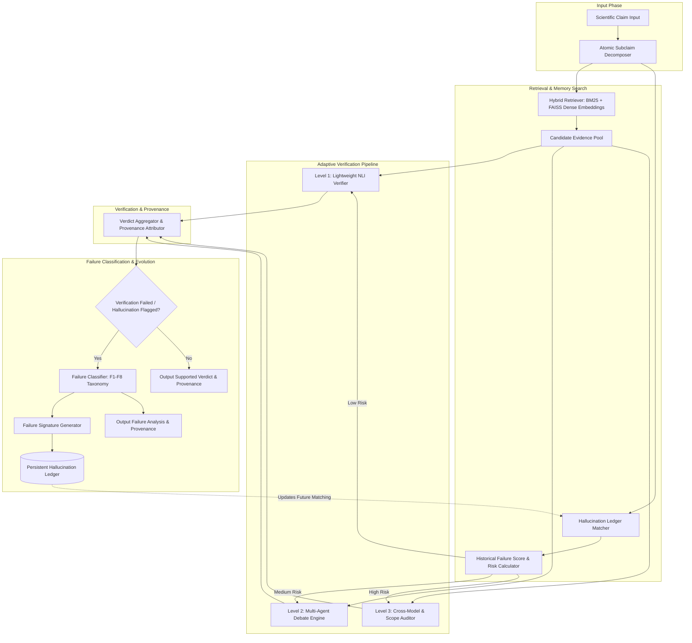

# CiteGuard System Architecture

## 1. System Overview

CiteGuard is an end-to-end, failure-aware scientific claim verification system that integrates Retrieval-Augmented Generation (RAG), fine-grained evidence attribution, structured failure signature generation, a persistent **Hallucination Ledger**, and risk-based adaptive multi-agent verification.

---

## 2. Component Diagram

---

## 3. Subsystem Breakdown

### 3.1 Subclaim Decomposition & Hybrid Retrieval (`src/retrieval/`)
* **Atomic Decomposer**: Splits complex multi-clause scientific claims into testable single assertions.
* **Hybrid Retriever**: Combines sparse keyword search (BM25) with dense vector semantic search (SentenceTransformers + FAISS) to retrieve section-level and sentence-level evidence.

### 3.2 Hallucination Ledger & Failure Signature Engine (`src/models/ledger.py`)
* **Failure Taxonomy (F1-F8)**: Classifies failures into 8 categories (Unsupported Claim, Citation Mismatch, Overgeneralization, Causal Leap, Outdated Evidence, Context Mismatch, Contradictory Evidence, Evidence Misinterpretation).
* **Failure Signature**: Encapsulates failure category, claim scope, evidence scope, population tags, and embedding vector.
* **Vector Ledger**: FAISS / Chroma DB vector index storing historical failure signatures.

### 3.3 Adaptive Multi-Agent Verification (`src/models/agents.py`, `src/models/verifier.py`)
* **Level 1 (Lightweight NLI)**: Fast cross-encoder entailment model (`roberta-large-mnli` / `deberta-v3-large`).
* **Level 2 (Multi-Agent Debate)**:
  * **Prosecutor Agent**: Searches for contradictions, scope mismatches, and evidence flaws.
  * **Skeptic Agent**: Evaluates evidence quality, metadata freshness, and sample sizes.
  * **Leader Agent**: Synthesizes argument weights and renders final verdict.
* **Level 3 (Cross-Model & Scope Audit)**: Runs cross-verification across diverse LLM backbones and explicitly validates claim scope vs study sample bounds.

### 3.4 Orchestration & CLI Layer (`src/pipeline.py`, `scripts/citeguard_cli.py`)
* **Input Validator (`src/utils/input_validation.py`)**: Sanitizes and validates incoming claim text length and format.
* **CiteGuardPipeline (`src/pipeline.py`)**: End-to-end integration wrapper connecting hybrid retrieval, adaptive agent verification, failure signature detection, and persistent ledger storage into a single pipeline call.
* **Command Line Interface (`scripts/citeguard_cli.py`)**: Provides top-level executable entry point with configurable retrieval modes, agent providers, evidence depth, and structured JSON export.

### 3.5 Evaluation Subsystem (`src/evaluation/`)
* Computes standard classification metrics (Precision, Recall, F1, AUROC).
* Measures **Repeated Hallucination Rate (RHR)** to quantify closed-loop learning across sequential evaluation passes.

