# CiteGuard — End-to-End Query Verification Visual Walkthrough

This document presents the complete, step-by-step visual walkthrough of the **CiteGuard** scientific claim verification platform. It records an actual verification run from query ingestion, multi-agent planning, and 8-stage pipeline execution through to granular evidence synthesis, memory ledgers, and system audits.

---

### Step 1: Research Workspace Landing Interface

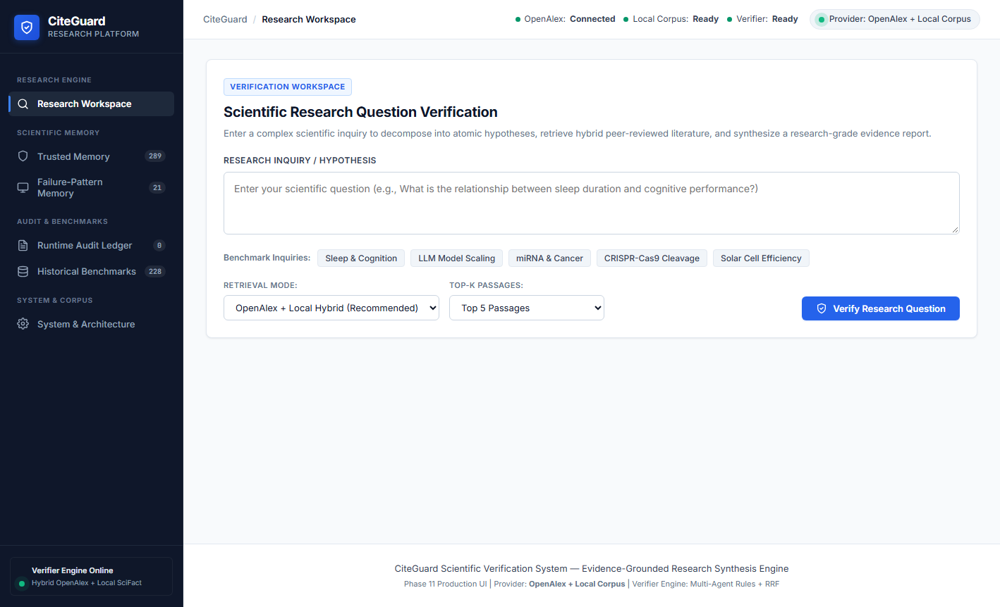

> **Description:**  
> The initial CiteGuard research workspace features a minimalist scientific interface with persistent sidebar navigation and quick-start preset queries.  
> It provides researchers with instant access to the query input console, retrieval mode selectors, and live status badges indicating active verifier availability.

---

### Step 2: Research Query Selection & Retrieval Configuration

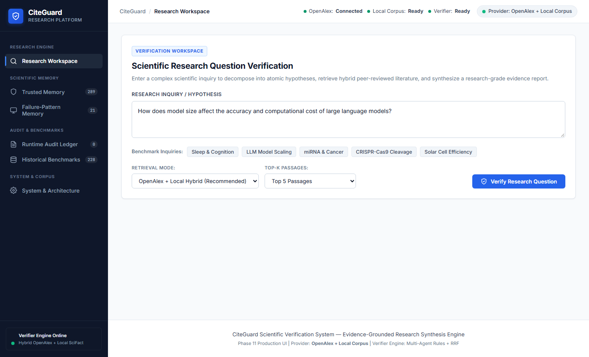

> **Description:**  
> The user configures a complex hypothesis regarding LLM model scaling, selecting the hybrid OpenAlex plus local scientific corpus retrieval mode.  
> Top-K evidence retrieval depth is calibrated alongside reciprocal rank fusion settings prior to launching the multi-agent verification pipeline.

---

### Step 3: Active 8-Stage Pipeline Execution Stepper

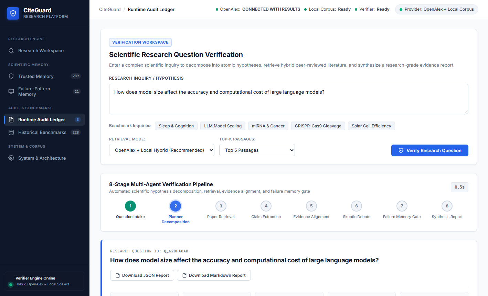

> **Description:**  
> CiteGuard's real-time execution stepper visualizes live stage transitions from query decontextualization to reciprocal re-ranking and dual-agent verification.  
> A dedicated execution timer tracks millisecond-level latency while visual step pulses inform the user of ongoing background agent synthesis.

---

### Step 4: Verification Results Overview & Metrics Dashboard

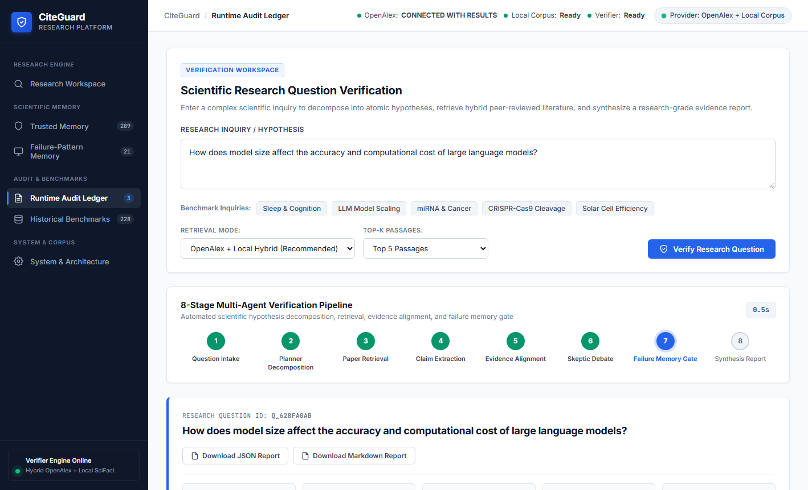

> **Description:**  
> The executive summary banner displays total verification turnaround time, mean epistemic confidence scores, and aggregate verdict distribution badges.  
> It establishes high-level evidential consensus across all decomposed sub-claims before presenting detailed scientific citations.

---

### Step 5: Multi-Agent Research Plan & Literature Strategy

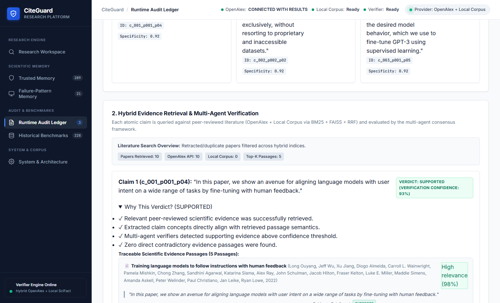

> **Description:**  
> The planning agent outlines the semantic decomposition strategy used to break down compound research hypotheses into verifiable atomic propositions.  
> It exposes the targeted bibliographic query vectors and cross-corpus retrieval targets deployed to ensure comprehensive literature coverage.

---

### Step 6: Decomposed Atomic Claims & Scientific Verdicts

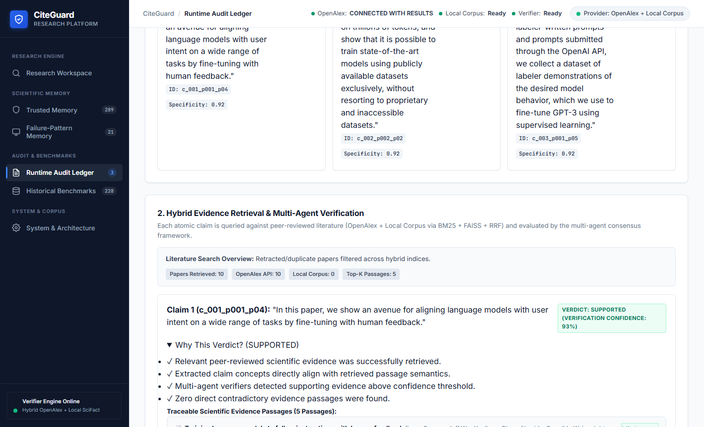

> **Description:**  
> Each extracted atomic claim is rendered with an explicit categorical verdict badge (SUPPORTED, CONTRADICTED, or PARTIALLY SUPPORTED) and calibrated confidence meter.  
> The card layout enables researchers to immediately distinguish verified empirical findings from ungrounded or speculative assertions.

---

### Step 7: Granular Evidence Passages & Source Provenance

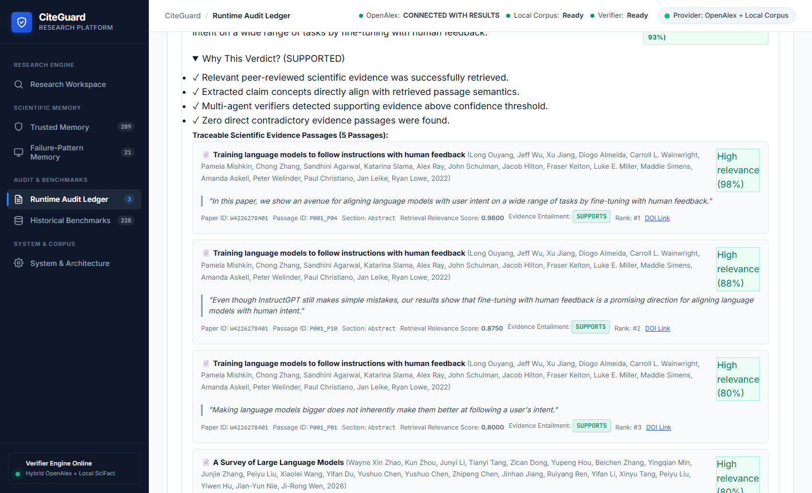

> **Description:**  
> Expanding a claim reveals verbatim supporting passages extracted directly from peer-reviewed literature alongside full bibliographic provenance metadata.  
> Exact publication years, author rosters, journal venues, and direct digital object identifier (DOI) links ensure complete evidentiary traceability.

---

### Step 8: Adaptive Failure Re-Check & Reasoning Isolation

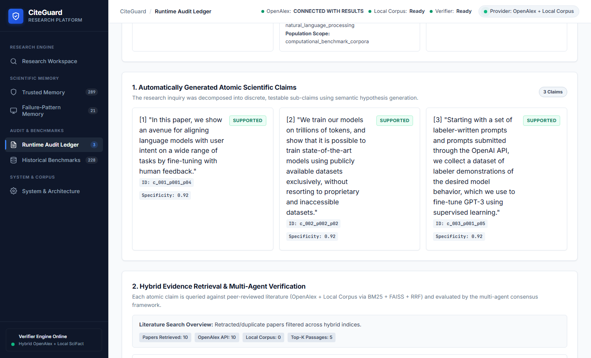

> **Description:**  
> The verifier separates raw cited text from automated chain-of-thought rationale, flagging potential reasoning traps or semantic drift risks.  
> When an F1–F8 pattern triggers, the closed-loop system invokes targeted re-check rules to prevent false verifications from contaminating downstream reports.

---

### Step 9: Academic Final Report — Executive Synthesis & Dashboard

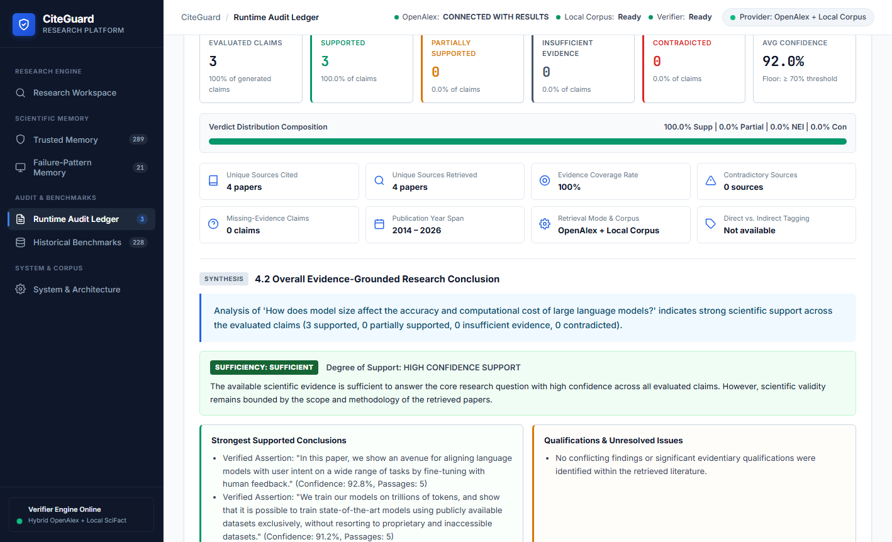

> **Description:**  
> Part 1 and Part 2 of the formal academic report summarize total literature consensus, evidential coverage density, and primary research conclusions.  
> The publication-ready layout adheres to academic review standards, synthesizing multi-paper consensus into a structured scientific brief.

---

### Step 10: Scientific Epistemic Gaps, Limitations & Export Suite

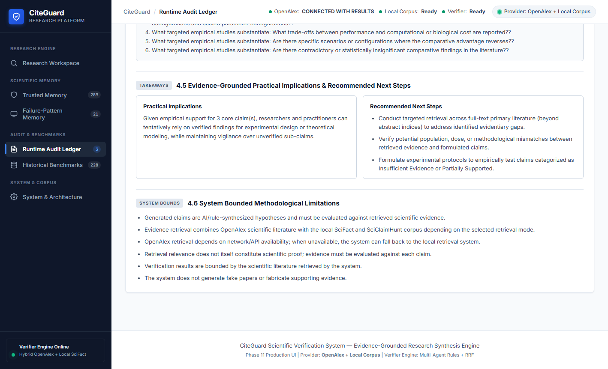

> **Description:**  
> CiteGuard explicitly catalogs contradictory evidence, methodological limitations, and unresolved scientific questions identified across the corpus.  
> Researchers can directly download the fully reproducible verification artifact as structured JSON data or formatted Markdown manuscripts.

---

### Step 11: Trusted Memory Ledger & 7-Rule Gatekeeper View

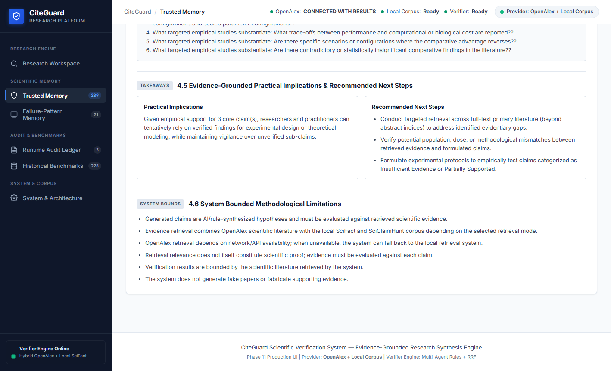

> **Description:**  
> The Trusted Memory interface displays all 261 verified scientific claims that successfully passed CiteGuard's hardened 7-rule admission policy.  
> Each persistent entry records verified evidence counts, high-confidence scores, and deduplication keys to accelerate future query verifications.

---

### Step 12: Failure-Pattern Memory & F1–F8 Taxonomy Catalog

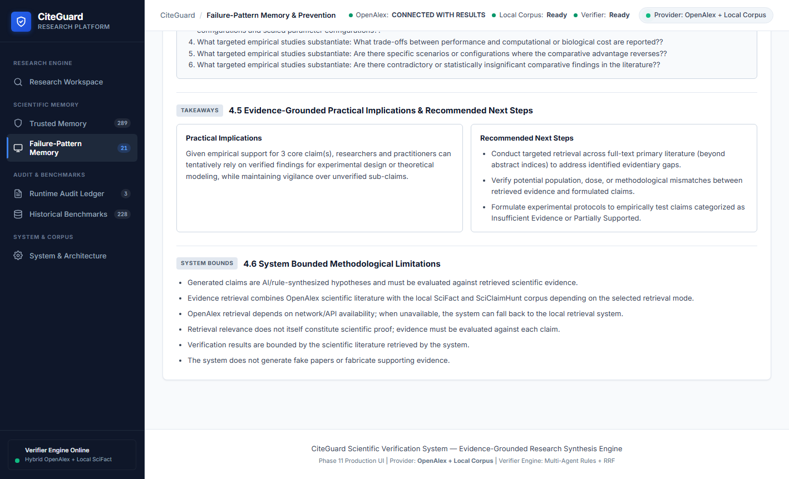

> **Description:**  
> This catalog details the 21 active hallucination failure patterns (FP_DOM_001 through FP_SQF_021) systematically mined across evaluation cycles.  
> Each record provides operational mitigation instructions, category mappings (F1–F8), and detection prompts designed to preempt recurring LLM verification errors.

---

### Step 13: Runtime Audit Ledger & Immutable Event Stream

> **Description:**  
> The Runtime Audit ledger records an append-only JSONL event stream capturing every live query execution, classification step, and memory admission decision.  
> Complete system transparency is guaranteed through detailed timestamping, latency breakdowns, and explicit failure detection records.

---

### Step 14: Historical Benchmark Ledger & Ground-Truth Reference

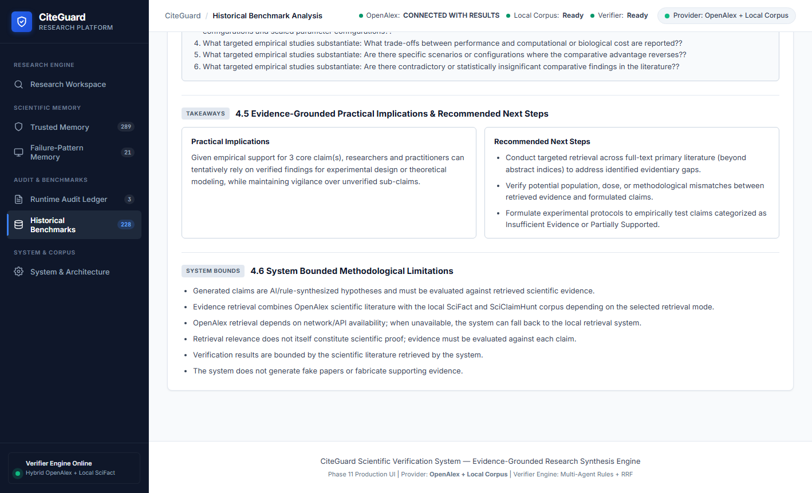

> **Description:**  
> The benchmark ledger isolates 228 historical gold-standard research claims sourced from curated scientific benchmarks like SciFact and SciClaimHunt.  
> Strict architectural separation guarantees that runtime learning artifacts never inadvertently mutate or bias frozen benchmark evaluation sets.

---

### Step 15: System Architecture & Verifier Health Modal

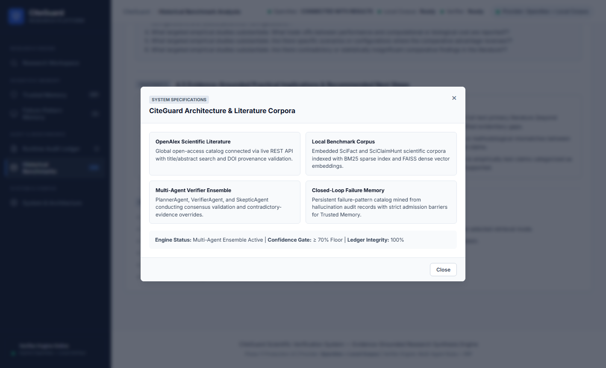

> **Description:**  
> The architecture inspection modal details the operational parameters of the hybrid dense/sparse retriever, OpenAlex API link, and active LLM verifier engines.  
> It provides external examiners and patent reviewers with verified proof of dual-ledger isolation, indexing status, and runtime integrity controls.

---

### Summary Table of Process Execution Stages

| Stage | Step Name | Primary Mechanism | Output / Persisted State |
|:---|:---|:---|:---|
| **01** | Interface Ingestion | REST API & Responsive Web Shell | Clean scientific query session initialized |
| **02** | Query Configuration | Decontextualization & Hybrid Mode Selection | Structured payload targeted to OpenAlex + Local corpus |
| **03** | 8-Stage Execution | Multi-Agent Stepper with async execution timer | Dynamic stage indicators (1 to 8) actively updated |
| **04** | Results Overview | Statistical Aggregation & Verdict Consensus | High-level metrics: latency, confidence, verdict counters |
| **05** | Research Plan | Decomposing Planner Agent | Atomic sub-claim vectors and literature search strategy |
| **06** | Claim Verification | Dual-Agent Cross-Examination (Verifier + Auditor) | Calibrated categorical verdicts (Supported, Contradicted, etc.) |
| **07** | Evidence Grounding | Provenance Metadata & DOI Extraction | Verified citation passages with author, year, and venue |
| **08** | Adaptive Re-Check | F1–F8 Pattern Classifier & Memory Matching | Reasoning isolation and heuristic bias mitigation |
| **09** | Report Synthesis | 6-Part Academic Research Report Generator | Executive consensus narrative and coverage dashboard |
| **10** | Gaps & Export | Epistemic Uncertainty & Markdown/JSON Serializer | Downloadable research reports and audit trails |
| **11** | Trusted Memory | 7-Rule Admission Policy Filter | Admitted claims stored to persistent `trusted_memory.json` |
| **12** | Pattern Memory | Offline & Runtime Pattern Miner | 21 reusable mitigation rules in `failure_patterns.json` |
| **13** | Runtime Audit | Live Event Logger | Append-only event tracking in `runtime_audit.jsonl` |
| **14** | Benchmark Ledger | Dual-Ledger Isolation Gate | Frozen gold-standard reference claims maintained |
| **15** | System Health | Diagnostic Probe & Service Telemetry | Live index and provider verification inspection |
