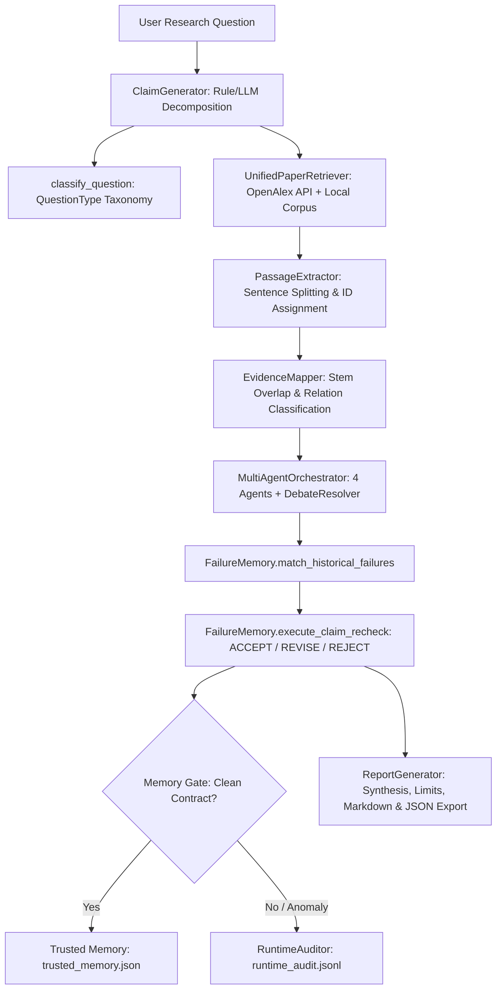

# CiteGuard: Current Codebase Architecture

**Document Version:** 1.0 (As Found in Source Code)  
**Date of Audit:** October 5, 2026  
**Repository Path:** `c:/Users/rajav/OneDrive/Desktop/nlp/nlp`  

---

## 1. System Overview

CiteGuard is an automated scientific research question processing and claim verification system. It integrates hybrid retrieval (sparse BM25 + dense FAISS vector embeddings + OpenAlex API), passage-level evidence extraction, multi-agent debate verification, dual-ledger audit logging, and a closed-loop failure-pattern memory engine.

---

## 2. Actual Codebase Execution Flow

In the current implementation ([`src/research_pipeline.py`](file:///c:/Users/rajav/OneDrive/Desktop/nlp/nlp/src/research_pipeline.py)), execution follows this concrete sequence:

### Detailed Stage Breakdown:

1. **Question Ingestion & Claim Generation (`src/claim_generation/`)**:
   - [`validate_research_question`](file:///c:/Users/rajav/OneDrive/Desktop/nlp/nlp/src/claim_generation/validator.py): Enforces length ($\ge 10$ chars), scientific keyword presence, and punctuation.
   - [`classify_question`](file:///c:/Users/rajav/OneDrive/Desktop/nlp/nlp/src/claim_generation/classifier.py): Classifies question into `GENERAL_SCIENTIFIC`, `HYPOTHESIS_TEST`, `BIBLIOGRAPHIC_SEARCH`, or `COMPARATIVE`.
   - [`ClaimGenerator`](file:///c:/Users/rajav/OneDrive/Desktop/nlp/nlp/src/claim_generation/generator.py): Decomposes the research question into atomic claims **prior to paper retrieval**. Uses regular expression pattern parsing (Rule 1: effect of X on Y, Rule 2: correlation between X and Y, Rule 3: how does X affect Y) or LLM generation.

2. **Paper Retrieval (`src/retrieval/`)**:
   - [`UnifiedPaperRetriever`](file:///c:/Users/rajav/OneDrive/Desktop/nlp/nlp/src/retrieval/paper_source.py): Coordinates between OpenAlex REST API and local corpus.
   - [`OpenAlexClient`](file:///c:/Users/rajav/OneDrive/Desktop/nlp/nlp/src/retrieval/openalex_client.py): Direct HTTP query to OpenAlex with rate limiting and retry logic.
   - [`HybridRetriever`](file:///c:/Users/rajav/OneDrive/Desktop/nlp/nlp/src/retrieval/hybrid.py): Merges BM25 lexical retrieval and FAISS dense vector search via Reciprocal Rank Fusion ($RRF$, $k=60$).
   - [`check_paper_domain_relevance`](file:///c:/Users/rajav/OneDrive/Desktop/nlp/nlp/src/retrieval/paper_evidence.py): Gating function checking domain keyword overlap (rejects off-domain papers like smart grids for quantum FL).

3. **Evidence Extraction & Mapping (`src/retrieval/`, `src/verification/`)**:
   - [`PassageExtractor`](file:///c:/Users/rajav/OneDrive/Desktop/nlp/nlp/src/retrieval/passage_extractor.py): Splits abstract/full-text into sentence-level chunks with deterministic IDs (`P001_P01`).
   - [`EvidenceMapper`](file:///c:/Users/rajav/OneDrive/Desktop/nlp/nlp/src/verification/evidence_mapper.py): Computes token overlap between claim and passages; assigns relationships (`SUPPORTS`, `CONTRADICTS`, `PARTIALLY_SUPPORTS`, `IRRELEVANT`).

4. **Multi-Agent Verification (`src/verification/`)**:
   - [`MultiAgentOrchestrator`](file:///c:/Users/rajav/OneDrive/Desktop/nlp/nlp/src/verification/orchestrator.py): Evaluates sufficiency, calls 4 agent assessors:
     - `EvidenceAgent`: Assesses passage quality and relevance.
     - `ClaimAnalysisAgent`: Assesses claim specificity and testability.
     - `SourceQualityAgent`: Checks publication year, citation count, and metadata.
     - `VerificationAgent`: Assesses final entailment.
   - [`DebateResolver`](file:///c:/Users/rajav/OneDrive/Desktop/nlp/nlp/src/verification/debate.py): Resolves agent disagreements through multi-turn structured debate.
   - Returns preliminary label (`SUPPORTED`, `CONTRADICTED`, `PARTIALLY_SUPPORTED`, `INSUFFICIENT_EVIDENCE`) and confidence score.

5. **Failure-Pattern Memory & Re-Check (`src/evaluation/failure_memory.py`)**:
   - [`FailureMemory.match_historical_failures`](file:///c:/Users/rajav/OneDrive/Desktop/nlp/nlp/src/evaluation/failure_memory.py#L99): Matches claim, evidence, and preliminary verdict against 9 canonical failure patterns from `results/hallucination_ledger/failure_patterns.json`.
   - Computes risk score (0.0 to 1.0) and risk level (`LOW`, `MEDIUM`, `HIGH`, `VERY_HIGH`).
   - [`FailureMemory.execute_claim_recheck`](file:///c:/Users/rajav/OneDrive/Desktop/nlp/nlp/src/evaluation/failure_memory.py#L234): Under heightened risk, activates adaptive actions (`REQUIRE_STRICT_DOMAIN_VALIDATION`, `ENFORCE_RELEVANCE_FLOOR_050`, `ESCALATE_TO_MULTI_AGENT_DEBATE`), filters out spurious evidence, revises preliminary verdict, and marks claim status as `ACCEPT`, `REVISE`, or `REJECT`.
   - **Memory Gate:** If claim verification passes cleanly (supported, confidence $\ge 0.70$, zero pattern matches), records into `results/hallucination_ledger/trusted_memory.json`.

6. **Dual-Ledger Hallucination Auditing (`src/evaluation/`)**:
   - [`RuntimeAuditor`](file:///c:/Users/rajav/OneDrive/Desktop/nlp/nlp/src/evaluation/runtime_auditor.py): Audits every evaluated runtime claim against verification contracts and appends records to `results/hallucination_ledger/runtime_audit.jsonl`.
   - [`HallucinationLedger`](file:///c:/Users/rajav/OneDrive/Desktop/nlp/nlp/src/evaluation/hallucination_ledger.py): Reads and maintains historical benchmark records from `results/hallucination_ledger/hallucination_ledger.jsonl`.

7. **Report Generation (`src/reporting/generator.py`)**:
   - Aggregates claims, verified verdicts, evidence passages, limitations, and synthesizes Markdown (`.md`) and JSON (`.json`) report artifacts saved to `results/reports/`.

8. **Web Interface & API (`src/ui/server.py`, `src/ui/static/`)**:
   - FastAPI backend running on port 8000 serving endpoints:
     - `POST /api/verify`: Executes `ResearchPipeline.run_pipeline()`.
     - `GET /api/status`: System status and active providers.
     - `GET /api/ledger/runtime`: Live query runtime audit logs.
     - `GET /api/ledger/benchmark`: Historical benchmark failure records.
     - `GET /api/ledger/patterns`: Learned failure patterns.
     - `GET /api/ledger/trusted`: Claims in trusted memory.
     - `GET /api/ledger/prevention-evaluation`: Quantitative self-correction metrics.
     - `GET /api/reports/{filename}`: Report file downloads.
   - Frontend: Vanilla JS/CSS single-page dashboard with stepper, results cards, and 3-way tabbed ledger navigation.

---

## 3. Current Taxonomy Implementations Found in Code

Currently, three distinct failure taxonomies exist simultaneously across modules:

1. **`src/evaluation/failure_taxonomy.py` (10 types)**:
   - `NO_EVIDENCE`, `WRONG_EVIDENCE`, `INSUFFICIENT_EVIDENCE`, `CONTRADICTORY_EVIDENCE`, `PARTIAL_EVIDENCE`, `RETRIEVAL_FAILURE`, `REASONING_FAILURE`, `LABEL_FAILURE`, `SOURCE_QUALITY_FAILURE`, `UNKNOWN_FAILURE`.
2. **`src/evaluation/runtime_auditor.py` (Ad-hoc runtime audit types)**:
   - `NO_EVIDENCE`, `DOMAIN_MISMATCH`, `CONTRADICTORY_EVIDENCE`, `UNGROUNDED_SUPPORT`, `UNGROUNDED_CONFIDENCE`, `CLEAN`.
3. **`src/evaluation/pattern_miner.py` (9 Pattern IDs)**:
   - `FP_DOM_001`, `FP_CON_006`, `FP_UNG_004`, `FP_CNF_005`, `FP_NEI_007`, `FP_CLM_009`, `FP_NUM_001`, `FP_DIR_001`, `FP_SCO_001`.

---

## 4. Current Test Suite Status

- **Runner**: PyTest 9.1.1 on Python 3.14.2 (Windows).
- **Test Count**: 198 items collected across 45 test files.
- **Pass Rate**: 198 passed, 0 failed, 2 warnings (134s - 520s execution time depending on model warm-up).
- **Coverage Areas**: Preprocessing, classification, retrieval (BM25, FAISS, OpenAlex, RRF), multi-agent debate, evidence mapping, dual ledgers, failure pattern memory, runtime auditor, UI server endpoints.
