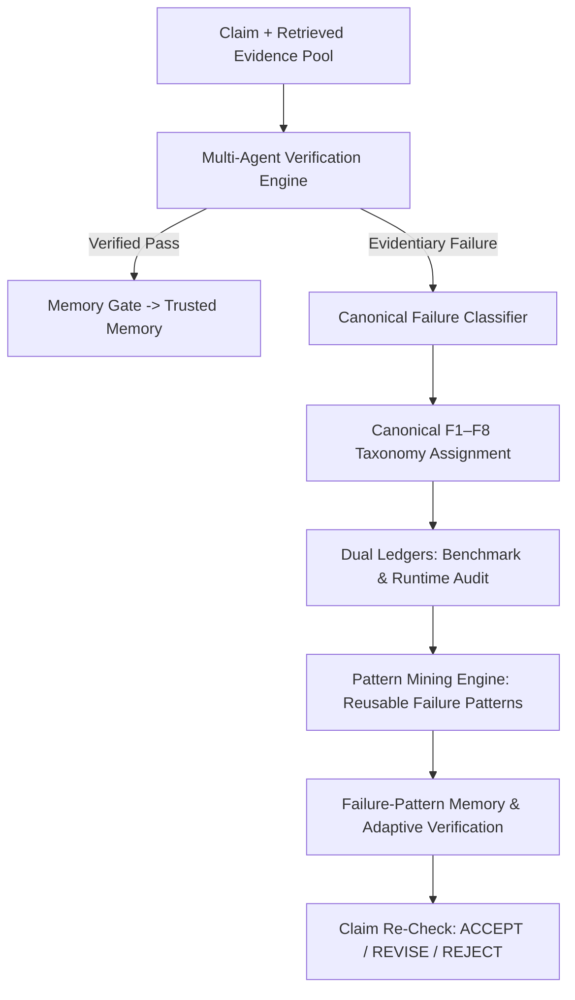

# CiteGuard Canonical Failure Taxonomy (F1–F8)

## 1. Overview & Architectural Role

CiteGuard implements a formal **Canonical 8-Class Scientific Failure Taxonomy (F1–F8)** as the authoritative standard across all verification, auditing, pattern mining, and failure-memory components. 

Rather than treating model inaccuracies as opaque, binary "hallucinations", CiteGuard analyzes observable evidence provenance, contextual compatibility, bibliographic citations, and semantic alignment to assign fine-grained, reproducible failure classifications.

---

## 2. Canonical Taxonomy Definitions (F1–F8)

| Code | Canonical Failure Name | Default Severity | Primary Scientific Mechanism | Adaptive Prevention Action |
|:---|:---|:---|:---|:---|
| **F1** | **Unsupported Claim** | `CRITICAL` / `HIGH` | Claim affirmed without qualifying empirical/textual evidence in literature pool | `FORCE_INSUFFICIENT_EVIDENCE`, `REQUIRE_MULTI_PASSAGE_AGREEMENT`, `CLAIM_RECHECK_SUFFICIENCY` |
| **F2** | **Citation Mismatch** | `CRITICAL` | Attribution to wrong source, missing DOI, unverified registry entry, or fabricated metadata | `STRICT_REGISTRY_LOOKUP`, `VERIFY_EXACT_DOI_SOURCE`, `REJECT_UNREGISTERED_DOIS` |
| **F3** | **Overgeneralization** | `MEDIUM` | Universal/unqualified assertion extrapolated from narrow study or high confidence on sparse evidence | `DYNAMIC_CONFIDENCE_RECALIBRATION`, `CAP_UNGROUNDED_CONFIDENCE`, `DOWNGRADE_TO_PARTIALLY_SUPPORTED` |
| **F4** | **Causal Leap** | `HIGH` | Asserting direct causation from purely correlational, observational, or co-occurrence data | `FLAG_CAUSAL_LEAP`, `MANDATE_CORRELATIONAL_QUALIFIER`, `REVISE_OR_REJECT_CLAIM` |
| **F5** | **Outdated Evidence** | `MEDIUM` | Relying on chronologically superseded, retracted, or obsolete findings for contemporary claims | `CHECK_TEMPORAL_RECENCY`, `EXCLUDE_RETRACTED_PAPERS`, `FILTER_OUTDATED_STUDIES` |
| **F6** | **Population/Context Mismatch** | `HIGH` | Applying evidence established in one domain/species/context to an incompatible target context | `REQUIRE_STRICT_DOMAIN_VALIDATION`, `EXCLUDE_OFF_DOMAIN_PASSAGES`, `CLAIM_RECHECK_DOMAIN_SCOPE` |
| **F7** | **Contradictory Evidence** | `CRITICAL` | Sustaining SUPPORTED verdict despite explicit refutations or counter-evidence in literature | `ESCALATE_TO_MULTI_AGENT_DEBATE`, `MANDATE_CONTRADICTION_DEBATE`, `FORCE_CONTRADICTED_OR_PARTIAL` |
| **F8** | **Evidence Misinterpretation** | `HIGH` / `LOW` | Distorting empirical statistics, directional flips, or syntactically malformed assertions | `ACTIVATE_ADVERSARIAL_REFUTER`, `VERIFY_EXACT_INTERVALS`, `REGENERATE_ATOMIC_CLAIM` |

---

## 3. Detailed Failure Class Specifications

### F1: Unsupported Claim
- **Definition**: Asserting or confirming claim support without qualifying empirical or textual evidence in the retrieved literature pool.
- **Scientific Rationale**: Scientific veracity requires strict evidential grounding. Affirming claims without cited or qualifying support introduces unverified speculation into synthesis.
- **Detection Criteria**:
  1. `len(evidence) == 0` with verdict `SUPPORT`.
  2. Highest evidence score $< 0.70$ when verdict is `SUPPORT`.
  3. Ground-truth evidence exists in corpus but zero candidate documents were retrieved in top-K (`RETRIEVAL_FAILURE`).
- **Default Severity**: `CRITICAL` (if `SUPPORT` without evidence), `HIGH` (if subthreshold score), `MEDIUM` (if zero evidence logged to audit under `INSUFFICIENT_EVIDENCE`).
- **Adaptive Actions**:
  - `FORCE_INSUFFICIENT_EVIDENCE`
  - `REQUIRE_MULTI_PASSAGE_AGREEMENT`
  - `CLAIM_RECHECK_SUFFICIENCY`

### F2: Citation Mismatch
- **Definition**: Attribution of findings to a cited source, paper ID, or DOI that does not substantiate the claim, or fabricated citation metadata.
- **Scientific Rationale**: Peer-reviewed science depends on verifiable provenance. Fabricated DOIs or misattributed citations destroy academic reproducibility.
- **Detection Criteria**:
  1. DOI string absent from OpenAlex or registered cross-reference index.
  2. Question requests exact DOI/citation metadata but retrieved paper has `null` DOI or unverified metadata.
  3. Metadata mismatch flag `citation_mismatch == True`.
- **Default Severity**: `CRITICAL`.
- **Adaptive Actions**:
  - `STRICT_REGISTRY_LOOKUP`
  - `VERIFY_EXACT_DOI_SOURCE`
  - `REJECT_UNREGISTERED_DOIS`

### F3: Overgeneralization
- **Definition**: Extrapolating a narrow, qualified finding to universal certainty, or expressing high confidence on sparse/preliminary evidence.
- **Scientific Rationale**: Empirical studies have defined boundary conditions. Generalizing single-cohort or in-vitro findings to universal populations creates false certainty.
- **Detection Criteria**:
  1. Model confidence $\ge 0.85$ with evidence count $< 2$ or highest score $< 0.65$.
  2. Universal quantifiers (`all`, `every`, `always`, `completely`) without multi-study meta-analytic support.
- **Default Severity**: `MEDIUM`.
- **Adaptive Actions**:
  - `DYNAMIC_CONFIDENCE_RECALIBRATION`
  - `CAP_UNGROUNDED_CONFIDENCE`
  - `DOWNGRADE_TO_PARTIALLY_SUPPORTED`

### F4: Causal Leap
- **Definition**: Inferring direct causal mechanisms (`X causes Y`, `X directly triggers Y`) from purely correlational or observational associations.
- **Scientific Rationale**: Correlation does not imply causation. Asserting causal intervention where literature only demonstrates epidemiological association misleads clinical or technical decisions.
- **Detection Criteria**:
  1. Causal claim markers (`causes`, `causally triggers`, `directly proves`, `leads directly to`) asserted when evidence text only indicates correlation markers (`correlated with`, `associated with`, `observational cohort`, `both increase`).
- **Default Severity**: `HIGH`.
- **Adaptive Actions**:
  - `FLAG_CAUSAL_LEAP`
  - `MANDATE_CORRELATIONAL_QUALIFIER`
  - `REVISE_OR_REJECT_CLAIM`

### F5: Outdated Evidence
- **Definition**: Relying on superseded, retracted, or chronologically outdated findings where newer literature contradicts or modifies the premise.
- **Scientific Rationale**: Scientific consensus evolves. Using obsolete pre-modern benchmarks (e.g. 2004 NLP assumptions for 2026 LLM questions) misrepresents current state of the art.
- **Detection Criteria**:
  1. Evidence publication year is $> 15$ years older than target claim year for fast-moving domains (quantum computing, LLMs, transformer architectures).
  2. Paper flagged as retracted or superseded in literature metadata (`is_superseded == True`).
- **Default Severity**: `MEDIUM`.
- **Adaptive Actions**:
  - `CHECK_TEMPORAL_RECENCY`
  - `EXCLUDE_RETRACTED_PAPERS`
  - `FILTER_OUTDATED_STUDIES`

### F6: Population/Context Mismatch
- **Definition**: Applying findings established in one specific population, organism, species, or scientific discipline to an incompatible target context.
- **Scientific Rationale**: Domain boundaries prevent catastrophic domain transfer errors (e.g., accepting power-grid distribution resilience papers to support quantum-resistant federated learning claims).
- **Detection Criteria**:
  1. Candidate passage fails compound domain gating (`evidence_eligible == False` or `topic_match == False`).
  2. Claim is in specialized domain (quantum cryptography/FL) but retrieved passages contain excluded domain keywords (smart grid, power distribution, drug discovery).
- **Default Severity**: `HIGH`.
- **Adaptive Actions**:
  - `REQUIRE_STRICT_DOMAIN_VALIDATION`
  - `EXCLUDE_OFF_DOMAIN_PASSAGES`
  - `CLAIM_RECHECK_DOMAIN_SCOPE`

### F7: Contradictory Evidence
- **Definition**: Sustaining a SUPPORTED verdict despite explicit refutations, counter-evidence, or directionality inversions in literature.
- **Scientific Rationale**: Overlooking refutations introduces confirmation bias, ignoring verified contradictions in scientific consensus.
- **Detection Criteria**:
  1. At least one retrieved passage exhibits `relation == CONTRADICT` or `metadata.relationship == CONTRADICT` while predicted verdict is `SUPPORT` or `SUPPORTED`.
  2. Directional flip detected (claim says "increases parameter efficiency", evidence says "degrades parameter efficiency by 40%").
- **Default Severity**: `CRITICAL`.
- **Adaptive Actions**:
  - `ESCALATE_TO_MULTI_AGENT_DEBATE`
  - `MANDATE_CONTRADICTION_DEBATE`
  - `FORCE_CONTRADICTED_OR_PARTIAL`

### F8: Evidence Misinterpretation
- **Definition**: Distorting or misreading statistical findings, p-values, directionality, or semantic relationships in evidence passages, or syntactic claim malformation.
- **Scientific Rationale**: A system must faithfully interpret empirical statistics and generate semantically valid, non-distorted claims.
- **Detection Criteria**:
  1. Syntactic claim malformation (e.g. awkward gerund prefixes like "altering increasing model size directly impacts...").
  2. Model predicts `SUPPORT` when ground truth literature is `REFUTE`.
  3. Numerical or statistical inversion (p-value $< 0.05$ misinterpreted as non-significant).
- **Default Severity**: `HIGH` (for empirical distortion), `LOW` (for syntactic gerund malformation).
- **Adaptive Actions**:
  - `ACTIVATE_ADVERSARIAL_REFUTER`
  - `VERIFY_EXACT_INTERVALS`
  - `REGENERATE_ATOMIC_CLAIM`

---

## 4. Mapping Legacy Signals to Canonical F1–F8

The following deterministic mapping preserves complete backward compatibility with all historical benchmarks, runtime ledgers, and existing test suites:

| Legacy Failure Signal | Legacy Enum Constant | Canonical Failure Code | Canonical Name |
|:---|:---|:---:|:---|
| `NO_EVIDENCE` | `FailureType.NO_EVIDENCE` | **F1** | Unsupported Claim |
| `INSUFFICIENT_EVIDENCE` | `FailureType.INSUFFICIENT_EVIDENCE` | **F1** | Unsupported Claim |
| `RETRIEVAL_FAILURE` | `FailureType.RETRIEVAL_FAILURE` | **F1** | Unsupported Claim |
| `UNGROUNDED_SUPPORT` | `FailureType.UNGROUNDED_SUPPORT` | **F1** | Unsupported Claim |
| `CITATION_FABRICATION` | `FailureType.CITATION_FABRICATION` | **F2** | Citation Mismatch |
| `METADATA_MISMATCH` | `FailureType.METADATA_MISMATCH` | **F2** | Citation Mismatch |
| `UNVERIFIED_BIBLIOGRAPHIC_METADATA`| - | **F2** | Citation Mismatch |
| `OVERGENERALIZATION` | `FailureType.OVERGENERALIZATION` | **F3** | Overgeneralization |
| `UNGROUNDED_CONFIDENCE` | `FailureType.UNGROUNDED_CONFIDENCE` | **F3** | Overgeneralization |
| `HIGH_CONFIDENCE_ON_SPARSE_EVIDENCE`| - | **F3** | Overgeneralization |
| `CAUSAL_LEAP` | `FailureType.CAUSAL_LEAP` | **F4** | Causal Leap |
| `CAUSAL_EXTRAPOLATION` | - | **F4** | Causal Leap |
| `OUTDATED_EVIDENCE` | `FailureType.OUTDATED_EVIDENCE` | **F5** | Outdated Evidence |
| `OUTDATED_SOURCE` | - | **F5** | Outdated Evidence |
| `TEMPORAL_MISMATCH` | - | **F5** | Outdated Evidence |
| `DOMAIN_MISMATCH` | `FailureType.DOMAIN_MISMATCH` | **F6** | Population/Context Mismatch |
| `WRONG_EVIDENCE` | `FailureType.WRONG_EVIDENCE` | **F6** | Population/Context Mismatch |
| `SCOPE_MISMATCH` | `FailureType.SCOPE_MISMATCH` | **F6** | Population/Context Mismatch |
| `SOURCE_QUALITY_FAILURE` | `FailureType.SOURCE_QUALITY_FAILURE` | **F6** | Population/Context Mismatch |
| `CONTRADICTORY_EVIDENCE` | `FailureType.CONTRADICTORY_EVIDENCE` | **F7** | Contradictory Evidence |
| `DIRECTIONALITY_INVERSION` | - | **F7** | Contradictory Evidence |
| `REASONING_FAILURE` | `FailureType.REASONING_FAILURE` | **F8** | Evidence Misinterpretation |
| `LABEL_FAILURE` | `FailureType.LABEL_FAILURE` | **F8** | Evidence Misinterpretation |
| `NUMERICAL_DISTORTION` | - | **F8** | Evidence Misinterpretation |
| `CLAIM_MALFORMATION` | `FailureType.CLAIM_MALFORMATION` | **F8** | Evidence Misinterpretation |

---

## 5. Mapping Mined Failure Patterns to Canonical F1–F8

The 9 reusable patterns in `results/hallucination_ledger/failure_patterns.json` are canonically classified as follows:

| Pattern ID | Pattern Name | Legacy Failure Type | Canonical Code | Canonical Failure Name |
|:---|:---|:---|:---:|:---|
| `FP_DOM_001` | `OFF_DOMAIN_EVIDENCE_ACCEPTED_AS_SUPPORT` | `DOMAIN_MISMATCH` | **F6** | Population/Context Mismatch |
| `FP_IRR_002` | `WEAK_OVERLAP_PASSAGE_INCLUDED` | `IRRELEVANT_EVIDENCE` | **F1** | Unsupported Claim |
| `FP_RET_003` | `GROUND_TRUTH_EVIDENCE_MISSED_IN_TOP_K` | `RETRIEVAL_FAILURE` | **F1** | Unsupported Claim |
| `FP_UNG_004` | `SUPPORT_VERDICT_WITH_SUBTHRESHOLD_EVIDENCE` | `UNGROUNDED_SUPPORT` | **F1** | Unsupported Claim |
| `FP_CNF_005` | `HIGH_CONFIDENCE_ON_SPARSE_EVIDENCE` | `UNGROUNDED_CONFIDENCE` | **F3** | Overgeneralization |
| `FP_CON_006` | `UNRESOLVED_CONTRADICTORY_EVIDENCE_OVERLOOKED` | `CONTRADICTORY_EVIDENCE` | **F7** | Contradictory Evidence |
| `FP_NEI_007` | `FALSE_SUPPORT_ATTEMPT_ON_EMPTY_EVIDENCE` | `INSUFFICIENT_EVIDENCE` | **F1** | Unsupported Claim |
| `FP_MET_008` | `UNVERIFIED_BIBLIOGRAPHIC_METADATA` | `METADATA_MISMATCH` | **F2** | Citation Mismatch |
| `FP_CLM_009` | `AWKWARD_GERUND_OR_NONSENSICAL_CLAIM` | `CLAIM_MALFORMATION` | **F8** | Evidence Misinterpretation |

---

## 6. Verification Contract State (Absence of Failure)

When a claim is verified with qualifying, on-topic peer-reviewed evidence ($\ge 2$ corroborating passages with relevance score $\ge 0.70$), zero contradiction signals, verified bibliographic metadata, and appropriate confidence calibration:
- `has_failure = False`
- `canonical_code = None`
- `canonical_name = "Clean Verification Contract"`
- `severity = "CLEAN"`
- `adaptive_action = "RECORD_TO_TRUSTED_MEMORY"`
- The claim bypasses the hallucination ledger and is recorded in `results/hallucination_ledger/trusted_memory.json`.
