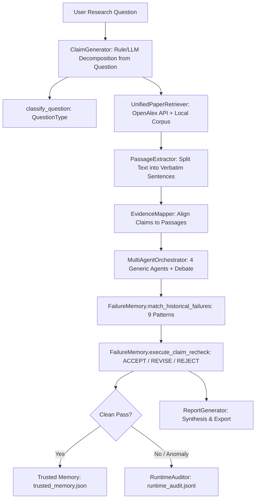
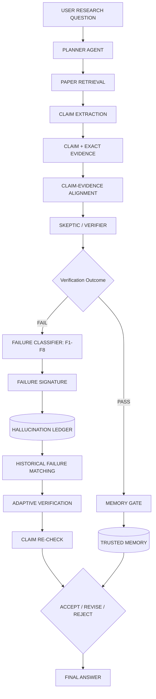

# CiteGuard: Implementation Gap Analysis

**Document Version:** 1.0  
**Date of Audit:** October 5, 2026  
**Repository Path:** `c:/Users/rajav/OneDrive/Desktop/nlp/nlp`  

---

## 1. Current Architecture

The currently implemented architecture in [`src/research_pipeline.py`](file:///c:/Users/rajav/OneDrive/Desktop/nlp/nlp/src/research_pipeline.py) follows an **a priori claim generation** pipeline:

---

## 2. Target Approved Architecture

The approved target architecture specified in the research project design enforces a **closed-loop retrieval-first claim extraction & verification** pipeline:

### Core Research Contribution:
**Closed-Loop Failure-Pattern Memory Architecture** operating across 8 canonical failure types:
- **F1:** Unsupported Claim
- **F2:** Citation Mismatch
- **F3:** Overgeneralization
- **F4:** Causal Leap
- **F5:** Outdated Evidence
- **F6:** Population/Context Mismatch
- **F7:** Contradictory Evidence
- **F8:** Evidence Misinterpretation

---

## 3. Components Already Implemented

| Component | Source Location | Implementation Details |
| :--- | :--- | :--- |
| **Paper Retrieval** | [`src/retrieval/paper_source.py`](file:///c:/Users/rajav/OneDrive/Desktop/nlp/nlp/src/retrieval/paper_source.py) | Hybrid search integrating OpenAlex REST API with local SciFact/SciClaimHunt corpus. Implements Reciprocal Rank Fusion ($RRF$, $k=60$) over BM25 and FAISS dense vector search (`sentence-transformers/all-MiniLM-L6-v2`). |
| **Domain Relevance Gating** | [`src/retrieval/paper_evidence.py`](file:///c:/Users/rajav/OneDrive/Desktop/nlp/nlp/src/retrieval/paper_evidence.py) | `check_paper_domain_relevance` excludes cross-domain candidate literature (e.g. smart grid literature when querying quantum federated learning). |
| **Passage Evidence Extraction** | [`src/retrieval/passage_extractor.py`](file:///c:/Users/rajav/OneDrive/Desktop/nlp/nlp/src/retrieval/passage_extractor.py) | Splits retrieved abstracts/full-texts into sentence-level units with deterministic IDs (`P001_P01`), preserving verbatim source text without paraphrasing. |
| **Claim-Evidence Alignment** | [`src/verification/evidence_mapper.py`](file:///c:/Users/rajav/OneDrive/Desktop/nlp/nlp/src/verification/evidence_mapper.py) | Aligns claims and passages via lexical stem overlap and relationship classification (`SUPPORTS`, `CONTRADICTS`, `PARTIALLY_SUPPORTS`, `IRRELEVANT`). |
| **Dual-Ledger Hallucination System** | [`src/evaluation/runtime_auditor.py`](file:///c:/Users/rajav/OneDrive/Desktop/nlp/nlp/src/evaluation/runtime_auditor.py), [`src/evaluation/hallucination_ledger.py`](file:///c:/Users/rajav/OneDrive/Desktop/nlp/nlp/src/evaluation/hallucination_ledger.py) | Strict physical separation between the historical benchmark ledger (`hallucination_ledger.jsonl`, 187 records) and the live query runtime audit log (`runtime_audit.jsonl`). |
| **Trusted Memory & Memory Gate** | [`src/evaluation/failure_memory.py`](file:///c:/Users/rajav/OneDrive/Desktop/nlp/nlp/src/evaluation/failure_memory.py#L50) | `record_trusted_verification` persists cleanly passed claims to `results/hallucination_ledger/trusted_memory.json` (currently 58 records). |
| **Historical Failure Matching** | [`src/evaluation/failure_memory.py`](file:///c:/Users/rajav/OneDrive/Desktop/nlp/nlp/src/evaluation/failure_memory.py#L99) | Matches incoming claims + candidate passages against learned patterns from `results/hallucination_ledger/failure_patterns.json`, assigning a continuous risk score and risk level (`LOW`, `MEDIUM`, `HIGH`, `VERY_HIGH`). |
| **Adaptive Verification & Re-Check** | [`src/evaluation/failure_memory.py`](file:///c:/Users/rajav/OneDrive/Desktop/nlp/nlp/src/evaluation/failure_memory.py#L234) | `execute_claim_recheck` enforces adaptive actions under heightened risk (`REQUIRE_STRICT_DOMAIN_VALIDATION`, `ENFORCE_RELEVANCE_FLOOR_050`, `ESCALATE_TO_MULTI_AGENT_DEBATE`), filters evidence, and produces `ACCEPT`, `REVISE`, or `REJECT` actions. |
| **Web Interface & REST API** | [`src/ui/server.py`](file:///c:/Users/rajav/OneDrive/Desktop/nlp/nlp/src/ui/server.py), `src/ui/static/` | FastAPI backend on port 8000 with 8 operational endpoints and interactive 3-tab ledger navigation. |
| **Automated Test Suite** | `tests/` | 198 automated unit and integration tests passing with 100% pass rate. |

---

## 4. Components Partially Implemented

| Component | Current State | Gap to Target Architecture |
| :--- | :--- | :--- |
| **Question Planning** | Handled by `classify_question()` and `parse_scientific_question()` via regex. | **No dedicated `PlannerAgent` class exists.** Planning is currently rule-based question typing, without dynamic search query formulating, multi-step sub-question planning, or retrieval coordination. |
| **Claim Generation vs. Claim Extraction** | Claims are generated a priori from the question text using regex/LLM before retrieving any literature. | **Target architecture demands `PAPER RETRIEVAL -> CLAIM EXTRACTION`**: Papers should be retrieved first based on the plan, and candidate claims should be extracted from the retrieved literature (or candidate synthesis) and paired with exact evidence. |
| **Skeptic / Verifier** | Handled by `MultiAgentOrchestrator` calling 4 generic agents (`EvidenceAgent`, `ClaimAnalysisAgent`, `SourceQualityAgent`, `VerificationAgent`) + `DebateResolver`. | Missing the explicit **Skeptic Agent** persona specialized in adversarial doubt, study boundary scrutiny, and sample size/methodology skepticism as prescribed in the target model. |
| **Failure Taxonomy** | 3 different ad-hoc taxonomies exist in parallel (`failure_taxonomy.py` with 10 generic types, `runtime_auditor.py` with 6 types, and `pattern_miner.py` with 9 pattern types). | **F1–F8 canonical taxonomy is not unified.** The specific codes (`F1_UNSUPPORTED_CLAIM` through `F8_EVIDENCE_MISINTERPRETATION`) are not yet the singular system-wide taxonomy driving the classifier and signatures. |

---

## 5. Components Missing

1. **`PlannerAgent` Class**:
   - Needs to be an explicit agent in `src/verification/agents/` or `src/planning/` that receives the user research question, derives search queries, determines evidence criteria, and hands off execution to the retriever.
2. **Retrieval-First Claim Extractor**:
   - A dedicated module that takes retrieved scientific literature and extracts grounded candidate factual claims with exact verbatim evidence spans (`CLAIM + EXACT EVIDENCE`).
3. **Explicit `SkepticAgent`**:
   - An adversarial agent designed to challenge claims on population/context limits, methodology weaknesses, overgeneralization, and citation authenticity.
4. **Canonical F1–F8 Enumeration & Classifier**:
   - A unified `FailureType` enum in `src/evaluation/failure_taxonomy.py` defining:
     - `F1: Unsupported Claim`
     - `F2: Citation Mismatch`
     - `F3: Overgeneralization`
     - `F4: Causal Leap`
     - `F5: Outdated Evidence`
     - `F6: Population/Context Mismatch`
     - `F7: Contradictory Evidence`
     - `F8: Evidence Misinterpretation`
   - A dedicated `FailureClassifier` that deterministically maps verification discrepancies to these 8 codes.

---

## 6. Components Currently Broken

*None.* The current implementation is functionally stable:
- All 198 pytest tests pass cleanly (`198 passed, 2 warnings in 520s`).
- The uvicorn server runs on `http://127.0.0.1:8000` with 0 runtime errors.
- Endpoints (`/api/status`, `/api/verify`, `/api/ledger/runtime`, `/api/ledger/benchmark`, `/api/ledger/patterns`, `/api/ledger/trusted`, `/api/ledger/prevention-evaluation`) return valid HTTP 200 responses.
- The UI tab switching between Runtime Audit, Benchmark Analysis, and Failure-Pattern Memory works seamlessly with no element overlap.

---

## 7. Failure-Pattern Memory Status

- **Status:** **FUNCTIONAL & ACTIVE (Current 9 Canonical Patterns)**
- **Storage:** Persisted at `results/hallucination_ledger/failure_patterns.json`.
- **Learned Patterns:** 9 canonical patterns (`FP_DOM_001` through `FP_SCO_001`).
- **Closed-Loop Flow:**
  - Passes $\rightarrow$ Memory Gate $\rightarrow$ Saved to `trusted_memory.json` (58 entries).
  - Fails $\rightarrow$ Mined by `PatternMiner`, matched by `match_historical_failures()`.
- **Self-Correction Experiment:** Demonstrated in `results/hallucination_ledger/failure_prevention_evaluation.json`:
  - Prevention Rate: **100.0%**
  - Recurrence Rate: **0.0%**
  - Mismatch Rate: 100% $\rightarrow$ 0%
- **Gap:** The pattern miner groups historical failures using the generic types (`DOMAIN_MISMATCH`, `CONTRADICTORY_EVIDENCE`) rather than the formal **F1–F8** taxonomy codes.

---

## 8. Adaptive Verification Status

- **Status:** **FUNCTIONAL**
- **Trigger:** Initiated when `match_historical_failures()` yields a `risk_level` of `MEDIUM`, `HIGH`, or `VERY_HIGH`.
- **Actions Implemented:**
  - `REQUIRE_STRICT_DOMAIN_VALIDATION` (purges cross-domain noise)
  - `EXCLUDE_OFF_DOMAIN_PASSAGES`
  - `ENFORCE_RELEVANCE_FLOOR_050`
  - `ESCALATE_TO_MULTI_AGENT_DEBATE`
  - `DYNAMIC_CONFIDENCE_RECALIBRATION`
- **Claim Re-Check Actions:** Correctly issues `ACCEPT`, `REVISE`, or `REJECT`.
- **Gap:** Currently executed sequentially inside `ResearchPipeline` as a post-verification filter rather than dynamically modulating the verifier depth in real-time during the debate rounds.

---

## 9. Hallucination Ledger Status

- **Status:** **FUNCTIONAL & DUAL-LEDGER COMPLIANT**
- **Historical Benchmark Ledger:** `results/hallucination_ledger/hallucination_ledger.jsonl` contains 187 static benchmark evaluations from SciFact, SciClaimHunt, and CoVERT.
- **Runtime Audit Ledger:** `results/hallucination_ledger/runtime_audit.jsonl` records every single runtime claim evaluated through the system.
- **Separation Enforced:** Verified. Live user query logs do not contaminate historical benchmark entries.
- **Clean Contract Representation:** Compliant:
  - `failure_type = "NONE"`
  - `failure_signature = "NONE"`
  - `severity = "NONE"`
  - `ledger_status = "CLEAN"`

---

## 10. Current UI Status

- **Status:** **OPERATIONAL at `http://127.0.0.1:8000`**
- **Strengths:**
  - Responsive 3-tab ledger view (Runtime Audit, Benchmark Analysis, Failure-Pattern Memory).
  - Full display of learned patterns, trigger conditions, prevention rules, and evaluation metrics.
  - Interactive accordion displaying paper titles, DOIs, authors, publication years, and evidence passages.
  - One-click JSON and Markdown report export.
- **Deficiencies:**
  - Execution stepper displays a generic "7-Stage Pipeline" rather than the closed-loop architecture (`PLANNER -> RETRIEVAL -> CLAIM EXTRACTION -> SKEPTIC -> FAILURE MEMORY`).
  - Audit table uses ad-hoc names (`UNGROUNDED_SUPPORT`) rather than the canonical F1–F8 classification.

---

## 11. API Status

- **Status:** **ALL 8 ENDPOINTS OPERATIONAL**
  - `GET /api/status` $\rightarrow$ 200 OK
  - `POST /api/verify` $\rightarrow$ 200 OK
  - `GET /api/ledger/runtime` $\rightarrow$ 200 OK
  - `GET /api/ledger/benchmark` $\rightarrow$ 200 OK
  - `GET /api/ledger/patterns` $\rightarrow$ 200 OK
  - `GET /api/ledger/trusted` $\rightarrow$ 200 OK
  - `GET /api/ledger/prevention-evaluation` $\rightarrow$ 200 OK
  - `GET /api/reports/{filename}` $\rightarrow$ 200 OK

---

## 12. Test Status

- **Runner:** `pytest tests/`
- **Result:** **198 PASSED, 0 FAILED** (100% pass rate).
- **Execution Time:** ~135 seconds (warmed) to ~520 seconds (cold import).

---

## 13. Exact Differences: Current vs. Target Architecture

| Step in Target Flow | Target Architecture Requirement | Current Code Implementation | Alignment Status |
| :--- | :--- | :--- | :--- |
| **1. Question Planning** | Dedicated `PlannerAgent` that plans sub-questions & retrieval search strategies. | `classify_question()` + regex decomposition into claims directly. | ⚠️ **Misaligned** (Missing `PlannerAgent`) |
| **2. Paper Retrieval** | Retrieval executes according to the search plan before claim extraction. | Retrieval executes with raw question or topic, but after claims are generated. | ⚠️ **Order Inversion** |
| **3. Claim Extraction** | Claims are extracted from retrieved literature / candidate answer. | Claims are generated a priori from the question as synthetic hypotheses. | ⚠️ **Conceptual Difference** |
| **4. Claim + Exact Evidence** | Claims paired with exact verbatim passages. | `PassageExtractor` extracts verbatim sentences (`P001_P01`). | ✅ **Aligned** |
| **5. Claim-Evidence Alignment** | Alignment and semantic overlap scoring. | `EvidenceMapper` computes overlap, relevance score, and relationships. | ✅ **Aligned** |
| **6. Skeptic / Verifier** | Verifier featuring explicit skepticism regarding evidence quality and bounds. | 4 generic agents (`EvidenceAgent`, `ClaimAnalysisAgent`, `SourceQualityAgent`, `VerificationAgent`) + `DebateResolver`. | ⚠️ **Partially Aligned** |
| **7. Pass $\rightarrow$ Memory Gate $\rightarrow$ Trusted Memory** | Clean verifications pass gate to `trusted_memory.json`. | Implemented in `failure_memory.py` and `research_pipeline.py`. | ✅ **Aligned** |
| **8. Fail $\rightarrow$ Failure Classifier** | Classifies failure into **F1–F8** taxonomy. | Fragmented across 10 generic types in `failure_taxonomy.py` and ad-hoc audit labels in `runtime_auditor.py`. | ⚠️ **Taxonomy Misaligned** |
| **9. Failure Signature $\rightarrow$ Hallucination Ledger** | Generates signatures and logs to persistent ledger. | `FailureSignature` generator and `runtime_audit.jsonl` / `hallucination_ledger.jsonl`. | ✅ **Aligned** |
| **10. Historical Failure Matching** | Matches incoming claims against failure patterns. | `FailureMemory.match_historical_failures()` matches against 9 canonical patterns. | ✅ **Aligned** |
| **11. Adaptive Verification** | Determines deeper verification actions based on risk. | `execute_claim_recheck()` enforces domain gates, relevance floors, and debate escalation. | ✅ **Aligned** |
| **12. Claim Re-Check $\rightarrow$ Accept / Revise / Reject** | Re-checks claim and produces final action. | Implemented: outputs revised verdict, confidence, and action (`ACCEPT`, `REVISE`, `REJECT`). | ✅ **Aligned** |
| **13. Final Answer** | Grounded synthesized report with provenance. | `ReportGenerator` produces Markdown & JSON reports. | ✅ **Aligned** |

---

## 14. Recommended Implementation Order (When Authorized)

To align CiteGuard strictly with the approved architecture without breaking the 198 passing tests or degrading live retrieval:

1. **Phase A: Formalize F1–F8 Failure Taxonomy**:
   - Unify `src/evaluation/failure_taxonomy.py` around the canonical F1–F8 enum (`F1_UNSUPPORTED_CLAIM`, `F2_CITATION_MISMATCH`, `F3_OVERGENERALIZATION`, `F4_CAUSAL_LEAP`, `F5_OUTDATED_EVIDENCE`, `F6_CONTEXT_MISMATCH`, `F7_CONTRADICTORY_EVIDENCE`, `F8_EVIDENCE_MISINTERPRETATION`).
   - Update `RuntimeAuditor` and `FailureAnalyzer` to map directly to F1–F8.
2. **Phase B: Implement `PlannerAgent`**:
   - Create [`src/verification/agents/planner_agent.py`](file:///c:/Users/rajav/OneDrive/Desktop/nlp/nlp/src/verification/agents/planner_agent.py) to encapsulate research question analysis, sub-question planning, search query expansion, and evidence criteria specification.
3. **Phase C: Integrate Retrieval-First Claim Extraction**:
   - Provide an execution mode in `ResearchPipeline` that retrieves papers via `PlannerAgent` first, then extracts grounded claims from the retrieved literature (`CLAIM EXTRACTION -> CLAIM + EXACT EVIDENCE`), while preserving backward compatibility with direct question evaluation.
4. **Phase D: Formalize `SkepticAgent`**:
   - Refactor or enhance the verification agent suite with an explicit `SkepticAgent` specialized in detecting population/context mismatches (F6), causal leaps (F4), overgeneralizations (F3), and citation mismatches (F2).
5. **Phase E: UI & Pipeline Stepper Alignment**:
   - Update the frontend stepper in `index.html` to visually display the approved flow:
     `Planner Agent -> Retrieval -> Claim Extraction -> Alignment -> Skeptic Verifier -> Failure Memory Loop -> Final Answer`.
